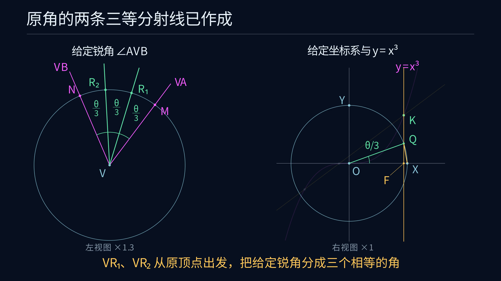

# Euclid-Cubic-Trisection

[简体中文](README.md) · **English**

**Given orthonormal coordinates, a unit length and the curve $y=x^3$, construct both trisectors of any acute angle with one line–cubic intersection query.**

This is the sixth project in the Euclid geometry research series. It provides a finite geometric construction, a proof covering every acute input, exact SageMath replay, independent verification and a Manim construction animation. The input angle may have any location and either orientation.

[Complete construction, Chinese](docs/ANSWER.md) · [Proof, Chinese](docs/PROOF.md) · [Reproduction](docs/REPRODUCING.md) · [Exact report](experiments/results/verification.json)

[](https://raw.githubusercontent.com/lenovobenben/euclid-cubic-trisection/main/animations/trisection/media/CubicTrisection_4k60.mp4)

*[Watch the 99-second 4K60 construction animation](https://raw.githubusercontent.com/lenovobenben/euclid-cubic-trisection/main/animations/trisection/media/CubicTrisection_4k60.mp4), with Chinese captions and a complete verified $60^\circ$ example.*

The movie follows the documented construction from copying the input angle through the cubic intersection to both output rays. It includes enlarged views of the intercept bisections and the nearby unit-circle points. Classical straightedge-and-compass macros are used for midpoints, parallels, perpendiculars and segment transfer. Storyboard, geometric regression tests and rendering instructions appear in the [animation guide](animations/trisection/README.md).

The original-angle view on the left is magnified by a factor of 1.3 relative to the coordinate view on the right. Both views display their scale factors.

## Problem and operations

The inputs are a fixed orthonormal coordinate frame, a common unit length, the complete curve $y=x^3$, and two rays forming an angle $0<\theta<\pi/2$. The output consists of the two interior trisecting rays at the original vertex, in order from the first input ray to the second.

Allowed operations include ordinary straightedge-and-compass constructions and obtaining the finite real intersections of a constructed line with the given cubic. Segment transfer, midpoints, parallels and perpendiculars use classical finite macros under collapsible-compass semantics. The cubic query is recorded separately and used exactly once. [Operation model](docs/DESIGN.md) · [Macro expansions](docs/CONSTRUCTION.md)

## Construction

1. Copy the angle to a unit circle in the given frame and project to obtain $c=\cos\theta$.
2. Construct the intercept $c/4$ and the fixed positive slope $3/4$, giving $L:y=3x/4+c/4$.
3. Intersect $L$ with $y=x^3$ and select the unique first-quadrant point.
4. Project its abscissa $t$ to the axis and lift it to the upper unit circle.
5. Transfer the resulting small chord twice on a unit circle at the original vertex to obtain both output rays.

The selected coordinate satisfies

$$4t^3-3t=c,\qquad \sqrt3/2<t<1.$$

There are exactly three distinct real roots, one in each of $(-1,-1/2)$, $(-1/2,0)$ and $(\sqrt3/2,1)$. The first-quadrant selection is therefore unique throughout the acute domain. The triple-angle identity gives the angle $\theta/3$. Equal-chord transfers produce the two correctly ordered rays at the original vertex.[Construction](docs/ANSWER.md) · [Proof](docs/PROOF.md)

## Exact verification

SageMath 10.7 uses rational and real-algebraic arithmetic throughout. The verifier independently checks the three adjacent angles using dot products, oriented cross products, unit lengths and strict interior tests.

| Check | Result |
|---|---|
| Symbolic polynomial identities | 9 passed |
| Intersection and degeneracy regressions | 9 passed |
| Command-line regressions | 3 passed, including negative fractional coordinates |
| Animation regressions | 8 groups passed, covering dependencies, incidence, close labels, magnified views, unfilled curves and distinct view scales |
| Full geometric replays | 40 passed, covering 10 angle families in 4 frames |
| Invalid inputs | 9 rejected according to the acute-domain contract |
| Given-cubic queries | 1 per construction, returning 3 distinct real points |

Fixtures include $30^\circ$, $45^\circ$, $60^\circ$, rational cosines, prescribed rational and quadratic target roots, and limiting inputs with cosine $10^{-30}$ or $1-10^{-30}$. The proof covers arbitrary real inputs. The exact implementation accepts algebraic coordinates, and the command-line interface accepts rational coordinates.[Coverage](docs/CASES.md) · [Verification](docs/VERIFICATION.md)

## Run

From the project root, with SageMath installed, run the following command.

```sh
sage -python experiments/verify.py
```

The pinned Docker command for macOS/Linux is below.

```sh
docker run --rm --network none \
  -e PYTHONDONTWRITEBYTECODE=1 \
  -v "$PWD:/workspace:ro" -w /workspace \
  sagemath/sagemath@sha256:4f5589eb6c565949a006f8665de2876b8414410daf5ac554f4434a15d4f3d528 \
  sage -python experiments/verify.py
```

Construct the trisectors of a specific angle using rational point coordinates.

```sh
sage -python experiments/trisection.py --first 1 0 --second 1 1
```

This example trisects a $45^\circ$ angle. Use `--vertex X Y` for another vertex. Integer and fractional coordinates such as `3/5` are supported. The result contains exact ray endpoints, the original and target cosines, orientation and cubic query count.

Add `--write` to the verification command with a writable mount to regenerate `experiments/results/verification.json` and `experiments/results/example.json`. Nonrational values are represented by minimal polynomials and rational isolating intervals. The report includes source hashes and the example-data hash. Windows commands and the algebraic-coordinate Python API appear in [REPRODUCING](docs/REPRODUCING.md).

## Files

| Purpose | Entry |
|---|---|
| Inputs, tools and output contract | [DESIGN](docs/DESIGN.md) |
| Complete construction and classical macros | [ANSWER](docs/ANSWER.md), [CONSTRUCTION](docs/CONSTRUCTION.md) |
| General proof and special cases | [PROOF](docs/PROOF.md), [CASES](docs/CASES.md) |
| Verification and reproduction | [VERIFICATION](docs/VERIFICATION.md), [REPRODUCING](docs/REPRODUCING.md) |
| Sources and contribution scope | [LITERATURE](docs/LITERATURE.md), [sources](sources/README.md) |
| Construction API and CLI | [trisection.py](experiments/trisection.py) |
| Exact geometric operations | [geometry.py](experiments/geometry.py) |
| Fixtures and verifier | [fixtures.py](experiments/fixtures.py), [verify.py](experiments/verify.py) |
| Complete exact example trace | [example.json](experiments/results/example.json) |
| Manim animation, data and rendering | [Animation guide](animations/trisection/README.md) |

## Sources and scope

The problem originates in the author's “尺规作图三等分角” question in `ai-math-notes`. The original response supplies the cosine-based route. This project completes the finite construction, the positive-slope reference, the three-root selection proof, both original-position output rays and exact independent verification. Historical priority and minimum-operation research remain future work.[Original exchange](sources/original_trisection_qa.md) · [Source ledger](docs/LITERATURE.md)

**Euclid geometry research series**

[Euclid-Min](https://github.com/lenovobenben/euclid-min) · [Euclid-CCC-Min](https://github.com/lenovobenben/euclid-ccc-min) · [Euclid-Equal-Angle-Min](https://github.com/lenovobenben/euclid-equal-angle-min) · [Euclid-Castillon-Min](https://github.com/lenovobenben/euclid-castillon-min) · [Euclid-Conic-Classification](https://github.com/lenovobenben/euclid-conic-classification) · **Euclid-Cubic-Trisection**

## License

Code and configuration use [Apache 2.0](LICENSE). Original mathematical documents, proofs, reports and research data use [CC BY 4.0](LICENSE-CONTENT). Source snapshots and dependencies retain their respective terms.[License scope](LICENSE-SCOPE.md)
