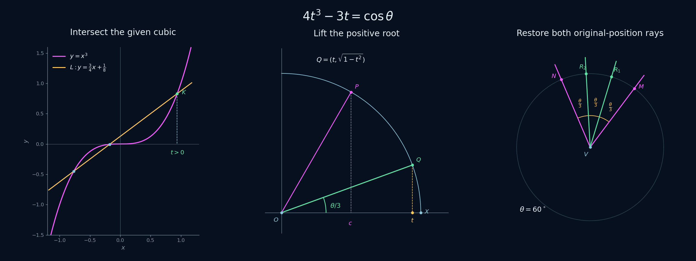

# Euclid-Cubic-Trisection · 借助立方曲线三等分角

**简体中文** · [English](README.en.md)

**给定坐标系、单位长度和曲线 $y=x^3$，用一次直线与曲线求交，构造任意锐角的两条三等分射线。**

本项目是 Euclid 几何研究系列的第六题。当前第一阶段已完成实际构造、全锐角正确性证明、SageMath 精确重放及独立核验。输入角可以位于平面任意位置，允许顺时针或逆时针排列。动画按计划在第二阶段单独制作。

[完整作图答案](docs/ANSWER.md) · [正确性证明](docs/PROOF.md) · [运行与复现](docs/REPRODUCING.md) · [精确核验报告](experiments/results/verification.json)



*静态图采用已精确核验的 $60^\circ$ 案例，依次展示曲线求交、单位圆提升及原位置的两条射线。*

## 题目与工具

给定正交坐标系、共同单位长度、整条 $y=x^3$ 曲线，以及锐角 $\theta$，其中 $0<\theta<\pi/2$。使用无刻度直尺、圆规及已作直线与给定曲线的有限实交点，构造原角内部的两条三等分射线。

中点、平行线、垂线和长度转移均采用经典有限尺规宏。圆规沿用系列的塌圆规语义。额外曲线求交单独记录，主构造恰调用一次。[输入与操作模型](docs/DESIGN.md) · [宏展开及成本口径](docs/CONSTRUCTION.md)

## 构造主线

1. 将原角复制到坐标原点的单位圆上，投影取得 $c=\cos\theta$。
2. 两次中分取得截距 $c/4$，用固定单位标记构造斜率为 $3/4$ 的方向，作直线 $L:y=\frac34x+\frac14c$。
3. 与给定的 $y=x^3$ 求交，取第一象限的唯一交点 $K$。
4. 将 $K$ 的横坐标投影并提升到单位圆上，取得 $\theta/3$。
5. 在原角的单位圆上复制两次相同弦长，得到原顶点发出的两条三等分射线。

若目标横坐标记为 $t$，则

$$4t^3-3t=c,\qquad \frac{\sqrt3}{2}<t<1.$$

三次方程始终有三个不同实根，另外两个位于 $(-1,-1/2)$ 和 $(-1/2,0)$。因此正根选点对全部锐角统一有效。第二次等弦复制取已有初边点之外的另一个交点，得到按原角方向排序的第二条射线。[完整作法](docs/ANSWER.md) · [存在性与唯一性证明](docs/PROOF.md)

## 代码与精确结果

构造程序按点、线、圆和曲线交点记录实际动作。SageMath 使用精确实代数数进行求交与选点，最终独立检查原角的三个相邻角具有相同余弦、相同正向正弦，并保持正确的角内次序。

| 核验内容 | 结果 |
|---|---|
| 符号恒等式 | 9 项通过 |
| 几何求交及退化回归 | 9 项通过 |
| 命令行入口回归 | 3 项通过，包含负分数坐标 |
| 完整作图 | 40 次通过，覆盖 10 个角参数族及 4 种位置方向 |
| 非法输入 | 9 项按严格锐角约定拒绝 |
| 立方曲线求交 | 每次构造 1 次，得到 3 个不同实交点 |

案例包括 $30^\circ,45^\circ,60^\circ$、有理余弦、预设有理或二次目标根，以及余弦为 $10^{-30}$ 和 $1-10^{-30}$ 的边界邻近输入。一般证明覆盖任意实坐标输入，程序支持实代数坐标，命令行支持有理数坐标。[特殊情形](docs/CASES.md) · [核验层次](docs/VERIFICATION.md)

## 运行

在项目根目录使用 SageMath 10.7 运行。

```sh
sage -python experiments/verify.py
```

Windows PowerShell 可使用与上一题相同的固定 Docker 镜像。

```powershell
docker run --rm --network none -e PYTHONDONTWRITEBYTECODE=1 -v "${PWD}:/workspace:ro" -w /workspace sagemath/sagemath@sha256:4f5589eb6c565949a006f8665de2876b8414410daf5ac554f4434a15d4f3d528 sage -python experiments/verify.py
```

也可以直接输入自己的角。以下例子为原点处的 $45^\circ$ 角，返回精确的两条三等分射线。

```sh
sage -python experiments/trisection.py --first 1 0 --second 1 1
```

通过 `--vertex` 指定原顶点，坐标可使用 `3/5` 等分数。Python 接口可接收一般实代数坐标。保存报告、精确证书格式和其他平台命令见 [REPRODUCING](docs/REPRODUCING.md)。

## 成果入口

| 内容 | 文件 |
|---|---|
| 题面、工具、输入和输出 | [DESIGN](docs/DESIGN.md) |
| 完整尺规构造 | [ANSWER](docs/ANSWER.md) |
| 尺规宏、动作对应和宏级成本 | [CONSTRUCTION](docs/CONSTRUCTION.md) |
| 全域正确性、选根及终止性 | [PROOF](docs/PROOF.md) |
| 特殊情形和边界 | [CASES](docs/CASES.md) |
| 验证方法和复现命令 | [VERIFICATION](docs/VERIFICATION.md)、[REPRODUCING](docs/REPRODUCING.md) |
| 题源、原回答订正和贡献范围 | [LITERATURE](docs/LITERATURE.md)、[sources](sources/README.md) |
| 主构造及命令行 | [trisection.py](experiments/trisection.py) |
| 精确几何、案例和统一核验 | [geometry.py](experiments/geometry.py)、[fixtures.py](experiments/fixtures.py)、[verify.py](experiments/verify.py) |
| 完整案例动作及精确点线圆 | [example.json](experiments/results/example.json) |

## 来源与项目定位

题目来自作者在 `ai-math-notes` 中的“尺规作图三等分角”问答，核心余弦路线保留其原始来源。项目将其展开为原位双射线构造、全锐角选根与终止性证明、精确代码和独立核验。原回答中参考斜率的表述、实根数量及第二条射线的取得在正式文档中补齐。[原始问答](sources/original_trisection_qa.md) · [来源与贡献范围](docs/LITERATURE.md)

本版记录一次曲线求交的构造上界，以及选定尺规宏的调用量。历史首创归属和最小步数为后续研究事项。

**Euclid 几何研究系列**

[Euclid-Min](https://github.com/lenovobenben/euclid-min) · [Euclid-CCC-Min](https://github.com/lenovobenben/euclid-ccc-min) · [Euclid-Equal-Angle-Min](https://github.com/lenovobenben/euclid-equal-angle-min) · [Euclid-Castillon-Min](https://github.com/lenovobenben/euclid-castillon-min) · [Euclid-Conic-Classification](https://github.com/lenovobenben/euclid-conic-classification) · **Euclid-Cubic-Trisection**

## 许可

代码与配置采用 [Apache 2.0](LICENSE)。原创数学文档、证明、核验报告和研究数据采用 [CC BY 4.0](LICENSE-CONTENT)。来源快照和外部依赖保持各自许可，具体范围见 [LICENSE-SCOPE](LICENSE-SCOPE.md)。
