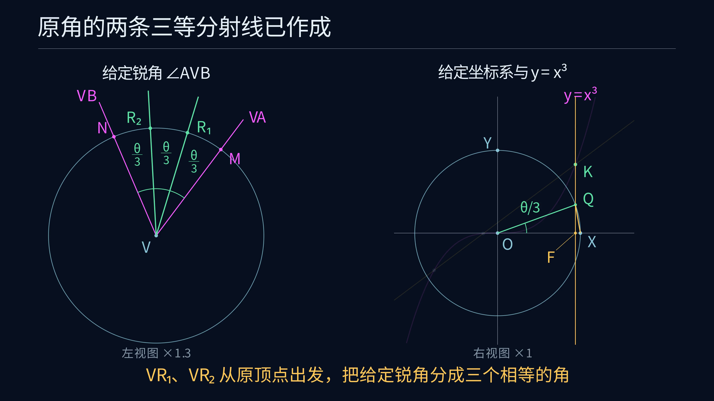

# 借助立方曲线三等分角的 Manim 动画

[观看 4K60 正式版](media/CubicTrisection_4k60.mp4)

正式成片为 3840 × 2160、60 fps、99 秒，共 5940 帧，文件约 16.6 MB。



## 展示范围

使用已经独立精确核验的 $60^\circ$ 案例，连续演示 [ANSWER](../../docs/ANSWER.md) 的全部构造。原角的顶点在 $(7,-11)$，初边方向为 $(3/5,4/5)$。左侧显示原角，右侧显示固定坐标系及给定曲线。左侧视图相对右侧放大 1.3 倍，画面分别标注“左视图 ×1.3”和“右视图 ×1”。

原角边上的标记 $A,B$ 距离顶点较远，画面以 `VA`、`VB` 标注两条射线方向。单位圆交点 $M,N$ 在精确位置显示。最终两条射线以原顶点 $V$ 为起点。

开头一页交代余弦三倍角原理，随后按几何步骤作图。中点、平行线、垂线和长度转移采用文档中的经典尺规宏，部分宏展开所需的标准辅助圆省略。用于复制角、转移余弦长度和复制小弦的圆均实际画出。[宏展开](../../docs/CONSTRUCTION.md)

沿用上一题的深蓝背景、中文说明和细线样式。洋红表示给定角及曲线，金色表示当前动作，淡蓝表示辅助图形，绿色表示目标交点、单位圆点和最终两条射线。

## 分镜与文档对应

| 阶段 | 实际作图与选点 | 文档位置 |
|---|---|---|
| 原理页 | 三倍角方程、目标直线、正根和两次等弦复制 | PROOF 第 3 至 7 节 |
| 原角复制 | 两个单位圆、$M,N$、以 $X$ 为圆心的弦长圆、上半平面交点 $P$ | ANSWER 第 2 节 |
| 余弦与截距 | 过 $P$ 作垂线取 $C$，画圆取得 $D$，两次中分取得 $E$ | ANSWER 第 3 节 |
| 参考方向 | 取得 $Y_{1/2},H$，作竖直线及水平线得 $W$，连接 $OW$，过 $E$ 作平行线 $L$ | ANSWER 第 4 节 |
| 曲线求交 | 显示三个实交点，选第一象限的 $K$ | ANSWER 第 5 节 |
| 单位圆提升 | 过 $K$ 作垂线取得 $F,Q$，连接 $OQ,XQ$ | ANSWER 第 6 节 |
| 第一条射线 | 以 $M$ 为圆心、$XQ$ 为半径画圆，取角内 $R_1$，作 $VR_1$ | ANSWER 第 7 节 |
| 第二条射线 | 以 $R_1$ 为圆心、过 $M$ 画圆，取另一个交点 $R_2$，作 $VR_2$ | ANSWER 第 8 节 |
| 完成图 | 按原角顺序标出三个相等角 | ANSWER 第 9 节 |

截距阶段放大 $OD$，逐次显示 $D_{1/2},E$。该案例的 $D$ 恰好与后续 $Y_{1/2}$ 重合，字幕和点名明确提示复用。单位圆提升阶段放大 $F,X,Q$，各点和父直线、圆弧使用同一相似变换。

## 精确数据与动作核对

`experiments/verify.py --write` 生成独立核验的精确案例和报告。随后 `experiments/export_animation.py` 对该案例重新执行几何及最终角核验，将重放证书与保存的精确案例逐字节比较，核对源码哈希后才转换为浮点显示数据。

[geometry.json](geometry.json) 包含全部点线圆、39 步原始作图记录及 229 个精确有理采样点的显示坐标。各采样点在转换前满足 $y=x^3$。Manim 加载时核对 [数据摘要](geometry.sha256)、精确案例及代码版本。

动画每次显示构造对象前都检查其父对象是否已出现。选点的父对象沿原始记录回溯到对应的求交直线、圆或给定曲线。影片使用一次直线与立方曲线求交所得的三个点。

成片的章节起始时间、构造对象出现顺序、视频参数、数据与动画源码哈希保存在 [timeline.json](media/timeline.json)。

## 环境与渲染

在项目根目录执行。沿用现有 `euclid-min-manim:0.21.0` 镜像，包含 Manim Community 0.21.0 和 Noto Sans CJK SC。也可以从本目录 Dockerfile 重建。

```powershell
docker build -t euclid-min-manim:0.21.0 animations/trisection
```

先更新正式核验，再导出动画数据。

```powershell
docker run --rm --network none -e PYTHONDONTWRITEBYTECODE=1 -v "${PWD}:/workspace" -w /workspace sagemath/sagemath@sha256:4f5589eb6c565949a006f8665de2876b8414410daf5ac554f4434a15d4f3d528 sage -python experiments/verify.py --write

docker run --rm --network none -e PYTHONDONTWRITEBYTECODE=1 -v "${PWD}:/workspace" -w /workspace sagemath/sagemath@sha256:4f5589eb6c565949a006f8665de2876b8414410daf5ac554f4434a15d4f3d528 sage -python experiments/export_animation.py
```

动作与显示几何回归测试如下。

```powershell
docker run --rm --network none -e PYTHONDONTWRITEBYTECODE=1 -v "${PWD}:/manim" -w /manim euclid-min-manim:0.21.0 python -m unittest discover -s animations/trisection -p 'test_*.py' -v
```

720p30 预览与 4K60 正式版分别采用以下命令。

```powershell
docker run --rm --network none -e PYTHONDONTWRITEBYTECODE=1 -v "${PWD}:/manim" -w /manim euclid-min-manim:0.21.0 manim --config_file animations/trisection/manim.cfg -r 1280,720 --fps 30 animations/trisection/trisection.py CubicTrisection

docker run --rm --network none -e PYTHONDONTWRITEBYTECODE=1 -v "${PWD}:/manim" -w /manim euclid-min-manim:0.21.0 manim --config_file animations/trisection/manim.cfg animations/trisection/trisection.py CubicTrisection
```

4K60 母片位于 `media/videos/trisection/2160p60/CubicTrisection.mp4`。播放版复制视频流并将索引前置。

```powershell
ffmpeg -y -i animations/trisection/media/videos/trisection/2160p60/CubicTrisection.mp4 -c copy -movflags +faststart animations/trisection/media/CubicTrisection_4k60.mp4
```

## 视觉与回归检查

检查原理页、复制角、截距放大、参考斜率、三根选点、单位圆放大、两次小弦复制及完成图。字幕位于底部，点名避开邻近圆点。$F$ 和 $X$ 使用分离圆点，$F$ 的标签用引线明确归属。

八组回归测试运行实际动画方法，检查完整文档顺序、父对象依赖、主图与放大图的点线圆关联、近点及标签分离、$D=Y_{1/2}$ 复用、最终文字边界、点名避开支撑直线、曲线与圆保持无填充，以及左右视图的 1.3 倍尺寸关系和缩放标注。精确几何证书的全锐角证明与 40 例核验继续保存在项目研究文档中。
